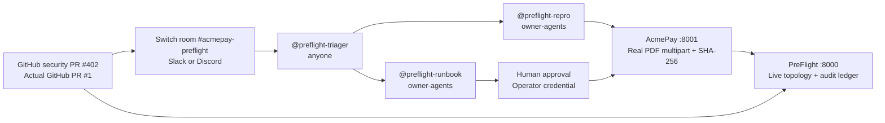

# PreFlight

**A release gate that tests whether the SDK, running API, and on-call runbook still agree.** Built for Flip the Switch with three Codex agents, a real AcmePay pull request, and reproducible binary evidence.

[AcmePay source](https://github.com/varmaleena/acmepay-invoice-service) · [Open security PR](https://github.com/varmaleena/acmepay-invoice-service/pull/1) · [Switch template](preflight.template.yaml) · [Technical deep dive](docs/BLOG_POST.md)

| A green backend test suite | What PreFlight finds |
| --- | --- |
| The 1 MB invoice fixture still passes. | The SDK admits a 4 MB PDF that receives HTTP 413 from the running API. |
| The backend uses a 2 MB limit. | The SDK and runbook still say 10 MB. |
| Runtime expects `MAX_RETRIES_V2`. | The SDK and incident recovery command still use `LEGACY_RETRY_LIMIT`. |

## One-command demo

From the cloned PreFlight checkout, with Git, Bash, curl, and Python 3.11+ installed:

```bash
./start_demo.sh
```

The launcher clones AcmePay as a sibling if missing, reuses healthy local services or starts them in separate virtual environments, and restores the known unpatched SDK and runbook. It refuses to overwrite unrelated tracked edits. Git Bash works on Windows. With Docker and Compose installed, `./start_demo.sh --docker` boots the same two-service topology with a shared target checkout.

| Live surface | URL |
| --- | --- |
| Workbench and interaction canvas | [localhost:8000](http://localhost:8000/) |
| Control-plane state | [localhost:8000/api/control-plane/state](http://localhost:8000/api/control-plane/state) |
| AcmePay runtime policy | [localhost:8001/health](http://localhost:8001/health) |
| AcmePay contract manifest | [localhost:8001/contract-manifest](http://localhost:8001/contract-manifest) |

Click **Stream Live Room Handoff** to watch the triager route two independent checks. The repro agent records both HTTP responses and the runbook agent produces a reviewable diff. The flow pauses for human approval. The **Approve & Push Fix** action requires an operator credential and approval reference, then verifies the fix before publishing it.

## Judging rubric

| Criterion | What to inspect |
| --- | --- |
| **Use of Switch · 30%** | The importable template creates a room and three agents with explicit addressing. Room history keeps the revision and evidence together, Rules define who can act, Tasks identify each handoff, and Decisions capture the human release decision. The bridge receives Switch SSE and forwards events over authenticated HTTP. |
| **Technical execution · 25%** | Two Git repositories, GitHub PR metadata, real unified Git diffs, AST inspection of Python policy, and actual multipart PDF requests. The ledger records sizes, response bodies, latency and SHA-256. The workbench streams events through a replayable SSE endpoint. |
| **Creativity and impact · 25%** | A backend-only security change can leave unit tests green while blocking merchant invoices and sending responders to a retired environment variable. The gate makes the cross-boundary impact reviewable before merge, when a P0-class failure can still be prevented. |



## Connect Switch

1. In Switch Console, go to **Templates → Import template** and load [preflight.template.yaml](preflight.template.yaml).
2. Select **Codex**, your configured Slack or Discord bridge, and the machine running both services. Enter the absolute path to this checkout as the working directory. Use the template and address `@preflight-triager` with the AcmePay PR link.
3. The triager accepts room requests. `owner-agents` permits the owner and their agents, so ordinary participants cannot address the two restricted agents directly. The repro instructions additionally check the sender identity for the designated triager. The API independently requires the operator token and approval reference for writes. [Switch template language](https://github.com/sandbox-quantum/switch/blob/main/docs/TEMPLATES.md)

For native relay traffic, set `SWITCH_SERVER_URL`, `SWITCH_AGENT_ID`, `SWITCH_AGENT_TOKEN`, `SWITCH_ROOM_ID`, and `PREFLIGHT_SWITCH_WEBHOOK_TOKEN`, then run `python -m agents.switch_protocol_bridge` from the project environment. The worker consumes the documented legacy SSE stream and forwards room events to the control-plane webhook. `--send-message` posts an explicitly supplied message through Switch. SSE is a compatibility transport on supported Switch servers. [Switch Agent Protocol](https://docs.switchagents.ai/switch-rooms/internals/agent-connection)

The local `--simulate-room-flow` option labels its transcript **Local room rehearsal**. It requires an explicit approval reference and the local operator credential. It exercises the same live API and Git checkout and applies the patch locally. Runtime transcripts and credentials stay out of version control.

## Publication and notifications

- `python -m agents.cli_tools remediate --push --comment-pr --approval-id <reference>` requires an operator credential, authenticated Git push access, and GitHub CLI access. GitHub comments use a table with evidence from the live ledger. Set `GITHUB_COMMENT_LIVE=1` only when you want verification executions to publish comments automatically.
- Set `DISCORD_WEBHOOK_URL` or use **Discord settings** in the workbench. The webhook URL is treated as a secret. Messages contain status and evidence summaries, and outgoing mention parsing is disabled.
- Ports bind to loopback in the launcher. The local ledger and credentials are intentionally excluded from the published source.
