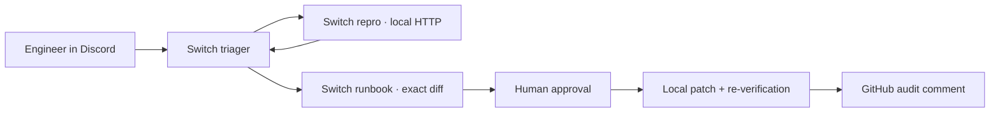

# PreFlight

**The API tests pass. A merchant's invoice still fails.**

PreFlight gives a release team one Switch room to find the mismatch, reproduce it against the running API, and approve the exact fix.

[Open the judge preview](https://preflight-acmepay-demo-evidence.vercel.app/) · [Follow the live demo guide](DEMO.md) · [Inspect the real AcmePay PR](https://github.com/varmaleena/acmepay-invoice-service/pull/1) · [Read the published audit](https://github.com/varmaleena/acmepay-invoice-service/pull/1#issuecomment-6705674111)

## The release bug

[AcmePay PR #1](https://github.com/varmaleena/acmepay-invoice-service/pull/1), titled **PR #402**, lowers the backend upload limit from **10 MiB to 2 MiB** and changes the retry variable to `MAX_RETRIES_V2`. The SDK still admits files up to **10 MiB**, and the on-call runbook still documents the old limit and retry variable. A backend suite can pass while merchants are offered uploads the service will reject.

| Real multipart probe | SDK size policy before the fix | Local AcmePay response | Evidence |
| --- | --- | --- | --- |
| 1.5 MiB PDF · 1,572,864 bytes | Allows | **HTTP 200** | Ledger event 104 · SHA-256 `a1d08ce44053…` |
| 4 MiB PDF · 4,194,304 bytes | Allows | **HTTP 413** | Ledger event 105 · SHA-256 `de69069d614c…` |

The captured requests ran against checkout `df746a7`. The [judge preview](https://preflight-acmepay-demo-evidence.vercel.app/) shows the full digests and measured latencies. With the SDK and runbook aligned, the 4 MiB API response should still be **413**. The fix lets the SDK reject the same file before upload.

## Why Switch is in the workflow

An engineer starts verification in the Discord-backed Switch room. The three Codex-backed identities have separate responsibilities, and the native listener checks sender and thread identity using authenticated Switch room history.

| Participant | Responsibility |
| --- | --- |
| **Triager** · `anyone` | Checks the hosted PR against the configured checkout, reports drift, and addresses the next agent through Switch. |
| **Repro** · `owner-agents` | Accepts the pinned triager's handoff, runs bounded multipart probes against local AcmePay, and posts HTTP outcomes and SHA-256 evidence in the thread. |
| **Runbook** · `owner-agents` | Posts the unified SDK/runbook diff and a proposal ID for human review. |
| **Human approver** | Replies in the same thread. PreFlight checks the linked identity, proposal, branch, commit, and reviewed diff digest before allowing the two-file edit. |

The workbench labels **Native Switch**, **Local orchestration**, **Rehearsal**, **Sandbox probe**, and **GitHub** evidence separately. Use `verify-switch-handoff` to check which stages a particular live run actually recorded.

## Reproduce it

Use Git, Python 3.11+, Bash, and curl. On Windows, install Git Bash and use `make.bat`.

| Task | Unix | Windows |
| --- | --- | --- |
| Set up both local environments | `make setup` | `make.bat setup` |
| Start services and verify the seeded checkout | `make demo` | `make.bat demo` |
| Run tests and diagnostics | `make verify` | `make.bat verify` |

1. Open the [local workbench](http://localhost:8000/). It reads AcmePay on port `8001`. Run `python -m agents.cli_tools verify-demo-state` from the PreFlight virtual environment to confirm the clean checkout matches the hosted PR. Use authenticated GitHub credentials if anonymous API access is rate-limited. [.env.example](.env.example) lists the available settings.
2. For the native path, use the linked approver account and the pinned Discord-backed room described in the [demo guide](DEMO.md). With the listener running, send `Run PreFlight verification for PR #402.` in the room. Reviewers can also select **Run Local Orchestration** to exercise the real Git and HTTP checks and produce the two-file proposal in the workbench.
3. Review the diff in Discord. Reply `Approved` for a local patch, `Rejected` to decline, or `Approve and merge <proposal-id>` to authorize GitHub publication and merge after the recheck. The merge path checks the reviewed commit and limits the fix to the two displayed files. Run `python -m agents.cli_tools verify-switch-handoff` to inspect the recorded steps. Missing proof appears as `NOT_OBSERVED`.

## What you can verify today

- **Real Git and HTTP.** The [revision check](app/demo_revision.py) compares the seeded checkout with the hosted PR. The [binary verifier](app/contract_verifier.py) sends multipart requests and hashes the actual bytes. The published audit and read-only Vercel preview give reviewers evidence they can open from any machine.
- **Review before write.** The [approval gate](app/agent_orchestrator.py) binds a decision to the reviewed digest, branch, and commit. It limits edits to `frontend_sdk/client_config.json` and `docs/oncall-runbook.md`. The test suites cover unauthorized senders, stale approvals, replays, and publication ordering. **25 tests passed** on the published implementation.
- **Evidence boundaries.** Native room delivery, triage, repro, and the posted patch proposal were verified. The ledger also records a prior local patch verification and a GitHub comment. The current proposal still needs the linked reviewer’s decision before it can produce a live after-check and merge receipt. Vercel serves the **read-only evidence page**. The interactive workbench, Switch listener, and AcmePay target run locally.

**Frameworks.** Switch Rooms and Codex power the native room integration. Python enforces the revision, probe, and approval rules. LangGraph is available for local orchestration. Google ADK is integrated for optional Gemini runbook advice and sits outside the native approval path.

## Scope

> PreFlight is a Switch-native release-verification room for API contract drift. When an engineer initiates verification for a pull request, PreFlight compares the backend contract with the frontend SDK and on-call runbook, executes controlled HTTP probes against a local target service, publishes SHA-256-backed evidence in the Switch room, and requires explicit human approval before applying a narrowly scoped SDK or documentation remediation.
>
> The current demo verifies the real 2 MiB backend upload limit versus the 10 MiB SDK allowance, reproduces the oversized-upload rejection with real HTTP evidence, and applies a human-approved local SDK/runbook patch. It does not yet automatically ingest every GitHub PR, modify backend code, enforce a GitHub merge block, or test production systems.
